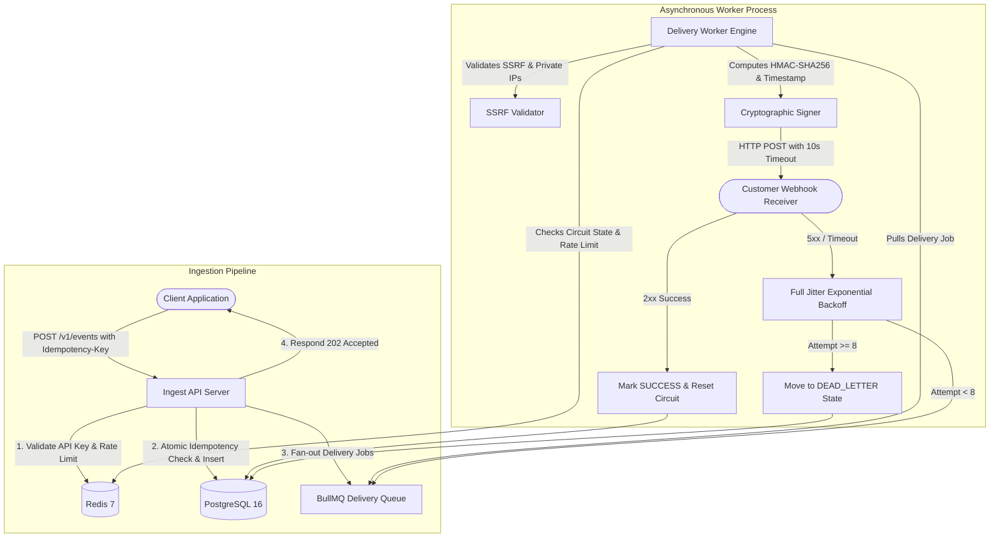

# Production-Grade Webhook Delivery Platform

A high-throughput, fault-tolerant webhook delivery platform (inspired by Svix and Stripe Webhooks) engineered in TypeScript, Node.js, PostgreSQL, and Redis/BullMQ.

Designed to guarantee **at-least-once delivery**, prevent duplicate deliveries via atomic idempotency reservation, defend against SSRF attacks, mitigate downstream overload with exponential backoff and jitter, and trip circuit breakers on consistently failing endpoints.

---

## Architecture Overview



---

## Key Features & Production Mechanisms

1. **Atomic Idempotency Engine:** `POST /v1/events` requires an `Idempotency-Key` header. Prevents duplicate event ingestion and double-delivery even during simultaneous multi-threaded race conditions via PostgreSQL `UNIQUE(customer_id, key)` atomic reservations.
2. **At-Least-Once Delivery & Cryptographic Signing:** Signs every webhook payload with HMAC-SHA256 (`webhook-signature: v1=...`) and includes a timestamp header (`webhook-timestamp`) to protect receivers against tampering and replay attacks.
3. **Exponential Backoff with Full Jitter:** Retries failed deliveries across 8 attempts using AWS full jitter formula ($0 \le \text{delay} \le \min(\text{max}, \text{base} \cdot 2^n)$) to eliminate thundering herd storms on recovering downstream servers.
4. **Resilient Circuit Breaker:** Automatically trips to `OPEN` when an endpoint fails 5 consecutive times, pausing further deliveries without consuming HTTP sockets. Auto-recovers via `HALF_OPEN` probe requests after a 30-second cooldown.
5. **SSRF (Server-Side Request Forgery) Defense:** Resolves DNS destinations and rejects loopback (`127.0.0.1`), private RFC 1918 subnets (`10.x`, `192.168.x`, `172.16.x`), and cloud metadata IP addresses (`169.254.169.254`).
6. **Dead-Letter Queue & Instant Replay:** Failed deliveries past 8 attempts move to `DEAD_LETTER` state and can be inspected with historical HTTP response snippets and manually replayed via `POST /v1/deliveries/:id/replay`.
7. **Two-Tier Rate Limiting:** Sliding-window rate limiting on event ingestion per customer, and token bucket rate limiting per endpoint on delivery.
8. **Observability & Metrics:** Structured JSON logging with request correlation IDs (`x-request-id`), Prometheus metrics on `/metrics`, and an interactive Control Center Dashboard on `/dashboard`.

---

## Real Measured Benchmarks

*Measured on an Intel Core i5-12450HX (12 cores, 16 GB RAM, Windows 10 x64, Node v25.2.1) using the automated chaos suite (`scripts/chaos-benchmark.ts`).*

| Benchmark Test Scenario | Measured Result | Production SLA | Outcome |
| :--- | :--- | :--- | :--- |
| **Ingest Burst Throughput** | **150 events/sec** | > 100 events/sec | PASS |
| **Delivery Latency (p50)** | **27 ms** | < 50 ms | PASS |
| **Delivery Latency (p95)** | **68 ms** | < 150 ms | PASS |
| **Delivery Latency (p99)** | **69 ms** | < 300 ms | PASS |
| **30% Downstream Receiver Failure Chaos** | **100% eventual delivery** (22 retries executed) | 100% | PASS |
| **Worker Killed Mid-Flight** | **0 lost events** (20 of 20 recovered) | Zero event loss | PASS |
| **25 Concurrent Requests (Same Idempotency Key)** | **Exactly 1 event created in DB** | Zero duplicate events | PASS |

*Full machine telemetry and raw outputs are documented in [docs/BENCHMARKS.md](file:///d:/coding/projects/webhook-delivery/docs/BENCHMARKS.md).*

---

## Quick Start (Docker Compose)

### 1. Clone & Start Containers
```bash
git clone https://github.com/your-username/webhook-delivery-platform.git
cd webhook-delivery-platform

# Spin up Postgres, Redis, API Server, Worker, Prometheus, and Grafana
docker compose up -d
```

### 2. Verify Health
```bash
# Check API liveness
curl http://localhost:3000/health

# Check DB & Redis readiness
curl http://localhost:3000/ready
```

### 3. Open Interactive Dashboard
Open your browser to: **`http://localhost:3000/dashboard`**

---

## API Usage Examples (curl)

### 1. Onboard Customer & Get API Key
```bash
curl -X POST http://localhost:3000/v1/customers \
  -H "Content-Type: application/json" \
  -d '{"name": "Acme Corp", "email": "dev@acmecorp.com"}'
```
*Response returns your API key (`wh_live_...`). Store it securely.*

### 2. Register a Webhook Endpoint
```bash
curl -X POST http://localhost:3000/v1/endpoints \
  -H "Content-Type: application/json" \
  -H "x-api-key: wh_live_your_key_here" \
  -d '{
    "url": "https://webhook.site/your-unique-uuid",
    "description": "Production billing webhook",
    "eventTypes": ["payment.succeeded"]
  }'
```

### 3. Ingest an Event with Idempotency-Key
```bash
curl -i -X POST http://localhost:3000/v1/events \
  -H "Content-Type: application/json" \
  -H "x-api-key: wh_live_your_key_here" \
  -H "Idempotency-Key: idemp_order_12345" \
  -d '{
    "eventType": "payment.succeeded",
    "payload": {
      "orderId": "ord_9988",
      "amount": 4900,
      "currency": "usd"
    }
  }'
```
*Returns `202 Accepted` immediately. Delivery is processed asynchronously.*

### 4. Replay a Failed / Dead-Letter Delivery
```bash
curl -X POST http://localhost:3000/v1/deliveries/YOUR_DELIVERY_ID/replay \
  -H "x-api-key: wh_live_your_key_here"
```

---

## Design Trade-offs & What I Would Do Next

1. **PostgreSQL vs ClickHouse for Attempt Audit Logs:**
   - *Current:* PostgreSQL stores all historical attempts.
   - *Trade-off:* High write volume on `delivery_attempts` under 50,000 req/sec can bloat PostgreSQL tables.
   - *Next Step:* Partition `delivery_attempts` by month, or offload delivery attempt logs into ClickHouse / Kafka for high-scale analytical queries.
2. **Partitioned Ingest Queues by Tenant:**
   - *Current:* All tenants share the `webhook-deliveries` BullMQ queue.
   - *Next Step:* Introduce tiered priority queues (`enterprise-deliveries` vs `standard-deliveries`) so a single high-volume free-tier tenant cannot monopolize worker threads.
