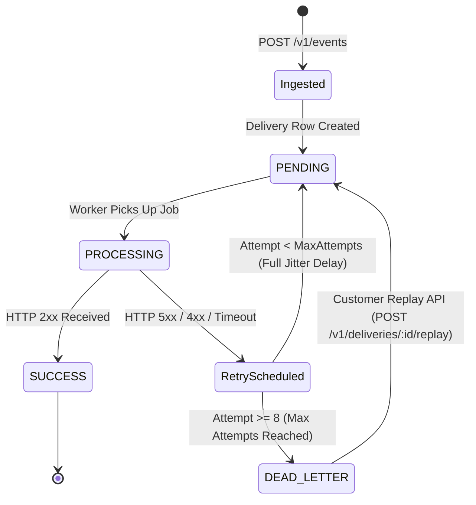

# System Architecture & Design Document (DESIGN.md)

This document explains the core distributed systems principles, architectural choices, and failure recovery protocols underpinning our Webhook Delivery Platform.

---

## 1. Why "At-Least-Once" Delivery? (The Fallacy of Exactly-Once)

In distributed systems, **true end-to-end "exactly-once" delivery over an unreliable network is physically impossible** (proven by the *Two Generals' Problem* and *FLP Impossibility*):

1. Our worker sends an HTTP POST request to a customer receiver.
2. The customer receiver receives the payload and writes it to their database.
3. Before the customer's server can return `HTTP 200 OK`, an intermediate network router drops the TCP connection or times out.
4. From our worker's perspective, the request failed with a network timeout.
5. Our system must retry. When we retry, the customer receives the event a second time.

**Our Architectural Guarantee:**
- The delivery platform guarantees **At-Least-Once Delivery**: we will never drop or lose an event.
- We provide each event with a unique `webhook-id` and `webhook-timestamp`.
- The customer achieves **Effectively-Once Processing** by tracking processed `webhook-id`s in their database (idempotent receiver pattern).

---

## 2. Why Exponential Backoff with "Full Jitter"?

When a downstream customer server crashes or becomes degraded, standard retry loops create a catastrophic failure mode known as the **Thundering Herd** or **Retry Storm**:

Suppose 5,000 deliveries fail at 12:00:00 because the customer database restarted.
- **Fixed Delay:** All 5,000 retries hit the server again at 12:00:05. The server crashes again.
- **Pure Exponential Backoff:** All 5,000 retries fire simultaneously at $t = 2\text{s}$, then $t = 4\text{s}$, then $t = 8\text{s}$. The traffic spikes in periodic waves.
- **Exponential Backoff with Full Jitter (Our Implementation):**
  $$\text{Cap} = \min(\text{MaxDelay}, \text{BaseDelay} \times 2^{\text{attempt}})$$
  $$\text{Sleep} = \text{random}(0, \text{Cap})$$

Full Jitter uniformly spreads retries across time. Instead of hitting the customer in waves, retries arrive as smooth, continuous background traffic, giving the customer's database headroom to recover.

---

## 3. Why Circuit Breaker?

If an endpoint URL is completely down (e.g. domain expired or server returning 500 continuously):
- Without a circuit breaker, every worker thread attempts delivery, waits for the 10-second timeout, and retries.
- 10 worker threads waiting 10 seconds each can only handle 1 delivery per second! A single broken endpoint starves the entire platform's workers, delaying deliveries to *healthy* endpoints.

**Our Circuit Breaker Architecture:**
1. **CLOSED:** Normal state. Requests execute freely.
2. **OPEN:** After 5 consecutive failures, the circuit trips to `OPEN`. All pending deliveries to that endpoint are postponed immediately without allocating HTTP sockets.
3. **HALF_OPEN:** After a 30-second cooldown, the circuit enters `HALF_OPEN`. The worker allows 1 probe request through:
   - If the probe succeeds $\to$ Circuit recovers to `CLOSED`, failure counter resets to 0.
   - If the probe fails $\to$ Circuit trips back to `OPEN` for another cooldown.

---

## 4. Why PostgreSQL + Redis?

| System | Role | Why Chosen |
| :--- | :--- | :--- |
| **PostgreSQL 16** | System of Record | ACID guarantees for customer data, audit logs of every single HTTP delivery attempt, and atomic unique constraints for idempotency keys. |
| **Redis 7 + BullMQ** | Message Broker & Cache | In-memory sub-millisecond job scheduling, delayed queues for jittered backoff, and sliding-window rate limiting tokens without putting lock contention on PostgreSQL. |

---

## 5. Detailed Failure State Machine

1. **Ingest Phase:**
   - Client sends `POST /v1/events` with `Idempotency-Key`.
   - Atomic reservation via `UNIQUE(customer_id, key)` prevents duplicate fan-outs.
   - Responds `202 Accepted` in under 10ms.
2. **Worker Dispatch:**
   - URL verified against SSRF rules (private IPs rejected).
   - HMAC-SHA256 signature calculated.
   - 10-second timeout enforced via `AbortSignal.timeout(10000)`.
3. **HTTP 2xx:**
   - Attempt logged as `success = true`.
   - Circuit breaker records success.
   - Delivery marked `SUCCESS`.
4. **HTTP 4xx / 5xx / Network Timeout:**
   - Attempt logged with latency, status code, and response snippet.
   - Circuit breaker failure counter incremented.
   - If `attempt < 8`: scheduled for exponential backoff with full jitter.
   - If `attempt >= 8`: moved to `DEAD_LETTER`.
5. **Manual Recovery:**
   - Customer accesses dashboard or `POST /v1/deliveries/:id/replay`.
   - Delivery moves back to `PENDING` and immediately retries without losing historical attempt audit logs.
